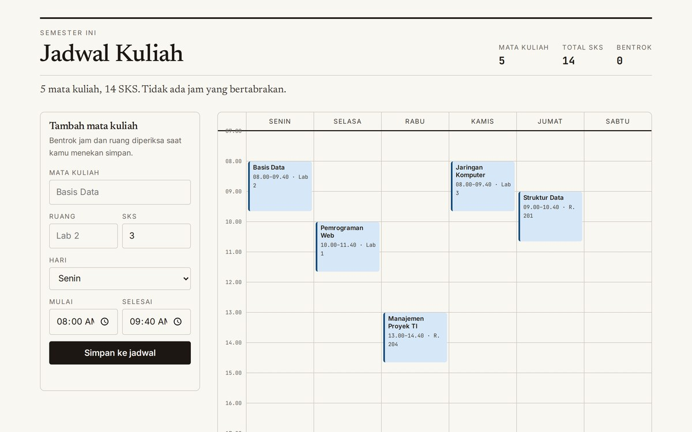

# Jadwal Kuliah

A weekly class planner with time-overlap detection, room conflict information, and automatic credit totals.

[Open demo](https://atmajadesna.github.io/jadwal-kuliah/)



## Features

- Class entry with day, room, time range, and credits.
- Weekly timetable with a compact agenda on narrow screens.
- Overlap detection using `a.start < b.end && b.start < a.end` on the same day.
- Schedule data persisted in local browser storage.
- Keyboard focus, readable form labels, and reduced-motion refinements.

## Run locally

```bash
python3 -m http.server 8000
```

Open `http://localhost:8000`. No build step is required. Fonts use Google Fonts.

## Files

`index.html` contains the interface, `app.js` manages schedule state and calculations, `styles.css` and `refinement.css` define the responsive components, and `tokens.css` supplies shared design variables.

## Limitations

This is a personal planning prototype, not an authoritative university registration system. Data is local to the browser and may be lost when storage is cleared. There is no account synchronization or server backup. Verify schedules against official course information.

## License

See [LICENSE](LICENSE).
